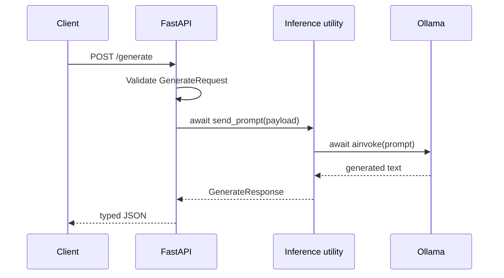

# FastAPI And Ollama

A language model on its own is not something other programs can call. In this
repository, [Ollama](https://ollama.com/) runs `qwen3.5:2b` on your machine and
[FastAPI](https://fastapi.tiangolo.com/) wraps it in an HTTP API (the
application layer), so any client
can send a prompt and get a typed JSON answer back. You will follow
one request through the supplied service, then start it and call it yourself.

The application layer has one narrow responsibility: validate HTTP input, call
the inference dependency, and return the declared response shape. Generation
logic stays outside the route so it can be replaced during tests.

## Follow One Request

`POST /generate` accepts a `GenerateRequest`. Pydantic rejects a missing or
empty prompt before Ollama is called and fills in the generation defaults for a
valid request. FastAPI then serializes the returned `GenerateResponse` and uses
the same models to generate the OpenAPI documentation at `/docs`.

The route itself only delegates, as defined in
[`llm_app/fastapi_llms.py`](llm_app/fastapi_llms.py):

```python
@app.post("/generate", response_model=GenerateResponse)
async def generate_text(payload: GenerateRequest) -> GenerateResponse:
    """Generate text with the configured local Ollama model."""
    return await send_prompt(payload)
```



### Design Choices

The route is asynchronous because local generation is an I/O wait from the
API's perspective. While Ollama works, the event loop can serve another request.
This does not make model inference itself faster.

`send_prompt` creates the model client with `OllamaLLM`, LangChain's Ollama
integration, and gives it a timeout from `OLLAMA_TIMEOUT` (120 seconds by
default). A generation that exceeds that limit becomes an HTTP `504` response,
which is different from an unexpected provider failure (`502`).

The client is also created with `reasoning=False`: Qwen's thinking tokens can
otherwise exhaust `max_tokens` before a final answer appears. Empty output is
also a provider failure, not a successful response. See
[Ollama thinking controls](https://docs.ollama.com/capabilities/thinking).

## Inspect The Contract

Make sure Ollama is running (see the README's
[Prerequisites](README.md#prerequisites)), then start the service from the
repository root:

```bash
uv run uvicorn llm_app.fastapi_llms:app --reload
```

Open <http://localhost:8000/docs> to see the generated documentation. Then send
the two requests below, either with **Try it out** on `POST /generate` or with
`curl` in a second terminal:

```bash
curl -X POST http://localhost:8000/generate \
  -H "Content-Type: application/json" \
  -d '{"prompt":"Explain asynchronous APIs in one sentence."}'
```

```bash
curl -X POST http://localhost:8000/generate \
  -H "Content-Type: application/json" \
  -d '{}'
```

The first request uses `qwen3.5:2b` and the declared defaults, and returns a
body like this:

```json
{"model": "qwen3.5:2b", "response": "..."}
```

The second should return status `422` without reaching Ollama. Its `detail`
lists `prompt` as a missing field.

The server log will also show `Redis GET failed` and `Redis SET failed`
warnings for each valid request. That is expected: Redis is not running yet,
so the service skips the cache and calls Ollama directly. Lesson 02 starts Redis.

Keep the API running in this terminal: lessons 02 and 04 send more requests to
it. Because of `--reload`, it picks up your code changes automatically.

## Check Your Understanding

1. Trace a request from [`llm_app/fastapi_llms.py`](llm_app/fastapi_llms.py)
   through [`llm_app/models.py`](llm_app/models.py) and
   [`llm_app/utils.py`](llm_app/utils.py). Which module owns HTTP routing, request validation,
   model-client creation, and error translation?
2. The `{}` request returned `422` without reaching Ollama. What rejected it,
   and why is it useful that this happens before the route runs?
3. The route is `async`. Does that make a single generation faster? If not,
   what does it improve?

<details>
<summary>Show Reference Answers</summary>

1. `fastapi_llms.py` owns routing: it maps `POST /generate` to
   `generate_text`. `models.py` owns validation through the Pydantic
   `GenerateRequest` model. `utils.py` owns model-client creation (it builds
   the `OllamaLLM` client in `send_prompt`) and error translation (it turns
   Ollama timeouts into `504` and other Ollama failures into `502`).
2. FastAPI validates the request body against `GenerateRequest` before calling
   the route. `prompt` is a required field with a minimum length of 1, so a
   missing prompt (or one that is only whitespace, which is stripped) is
   rejected with `422`. Invalid input never reaches the model, so it costs no
   generation time and the route code only ever handles valid requests.
3. No. Ollama takes just as long to generate the answer. While the route awaits
   Ollama, the event loop is free to accept and serve other requests, so one
   slow generation does not block the whole API.

</details>
