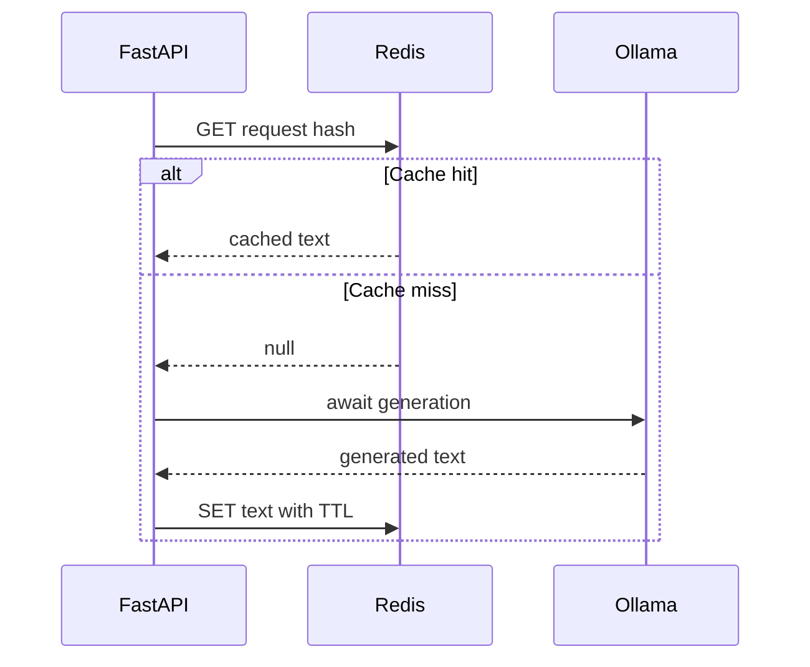

# Redis Cache

In lesson 01, every request went to Ollama even when you sent the same prompt
twice. Local generation
takes seconds and uses your machine's compute, so repeating it for an identical
request is wasted work. In this lesson you start Redis and watch the service
reuse stored answers for requests whose generation parameters are exactly the
same.

## Cache Identity

`build_cache_key` in [`llm_app/utils.py`](llm_app/utils.py) hashes model,
temperature, output-token limit, prompt, and the fixed reasoning setting. Leave
one out and the cache can serve the wrong answer. If `max_tokens` were not part
of the key, a request with `max_tokens: 20` would store a truncated,
mid-sentence reply, and a later request for the same prompt with
`max_tokens: 500` would get that truncated reply back instead of a full answer.

SHA-256 keeps every key the same length, whatever the prompt size. Hashing is
not anonymization, though: the response is stored in plain text, and anyone who
can guess a prompt can recompute its key.

Each entry is stored with a time to live (TTL): Redis deletes it automatically
after `CACHE_TTL` seconds (3600 by default, set in `.env`), so old answers do
not stay in the cache forever.

The diagram below follows one request. The `alt` block shows the two paths it
can take: a cache **hit** or a cache **miss**.



## Observe The Cache

Make sure Docker Desktop is running, then start Redis with the supplied Compose
service:

```bash
docker compose up -d
```

The API from lesson 01 connects to Redis on its next request, so you do not
need to restart it.

Send the same request twice, either with `curl` or with **Try it out** on
`POST /generate` at <http://localhost:8000/docs>:

```bash
curl -X POST http://localhost:8000/generate \
  -H "Content-Type: application/json" \
  -d '{"prompt":"Explain asynchronous APIs in one sentence."}'
```

The first request takes a few seconds while Ollama generates. The second
returns almost immediately because Redis serves it. The `Redis GET failed` and
`Redis SET failed` warnings from lesson 01 no longer appear in the server log.

Inspect the cache:

```bash
docker exec llms_redis redis-cli DBSIZE
docker exec llms_redis redis-cli --scan
```

`DBSIZE` counts one entry per distinct request, so after sending the same
request twice it prints `1`. `--scan` lists that key: `llm-webservice:`
followed by 64 hexadecimal characters. Check how long the entry has left,
replacing `<key>` with the key printed by `--scan`:

```bash
docker exec llms_redis redis-cli TTL <key>
```

The result is the number of seconds remaining, counting down from `3600`.

`--scan` walks the keys in small batches. Prefer it over `KEYS *`, which blocks
Redis while it reads the whole keyspace and can stall a production server.

## Failure Boundary

Redis is an optimization, not the source of the response. A failed read should
fall through to Ollama, and a failed write should still return the generated
text. An Ollama failure is different: the service cannot produce the requested
result and should return an upstream error.

Each Redis read and write has a one-second deadline in `send_prompt`. If Redis
is slow or unreachable, the service gives up on the cache after at most a second
per step instead of leaving the request waiting.

Empty or whitespace-only output is never cached. Existing empty entries are
treated as cache misses so a failed generation cannot poison repeated requests.

## Check Your Understanding

1. Predict whether each pair of requests shares a cache entry:
   - the same prompt with different temperatures,
   - the same parameters sent with the JSON fields in a different order,
   - prompts that differ only by capitalization (`Hello` and `hello`),
   - prompts that differ only by surrounding spaces (`Hello` and `  Hello  `).
2. Redis stops while the API is running. What happens to the next request?
3. Why does the service never cache an empty model response, and what happens
   when an empty entry is already in Redis?

<details>
<summary>Show Reference Answers</summary>

1. - **Different temperatures: separate entries.** Temperature is part of the
     hashed key.
   - **Different field order: shared entry.** The key is built from the
     validated `GenerateRequest` fields with `json.dumps(..., sort_keys=True)`,
     so the order of fields in the incoming JSON has no effect.
   - **Different capitalization: separate entries.** The prompt string is
     hashed exactly as sent; this is exact-match caching, not semantic caching.
   - **Surrounding spaces: shared entry.** `GenerateRequest` strips leading and
     trailing whitespace from strings during validation, before the key is
     built.
2. The request still succeeds. The Redis read fails or hits its one-second
   deadline, the service logs a warning and calls Ollama instead. The Redis
   write after generation also fails with a warning, and the generated answer
   is still returned. The request is at most slightly slower, because Redis is
   an optimization, not the source of the response.
3. An empty response is a failed generation: the service returns `502` and does
   not store it. Caching it would serve the same blank answer to every
   identical request until the TTL expires. If an empty or whitespace-only
   entry is already in Redis, `send_prompt` treats it as a cache miss, calls
   Ollama again, and overwrites the entry with the new answer.

</details>
