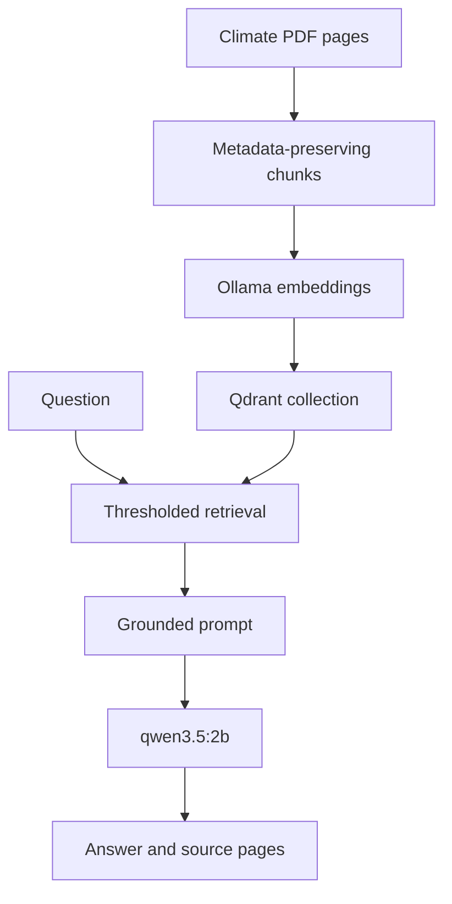

# RAG Extension

This guided exercise adds a second request path for questions grounded in the
supplied climate change report. The `/generate` path is already implemented;
you complete the RAG helpers and `/climate-change` route. Retrieval and
generation remain distinct steps so each can be inspected and tested.



The exercise has two parts. Do them in this order:

1. **Part 1, in the notebook:** build and inspect the retrieval path step by
   step in [rag-extension-starter.ipynb](rag-extension-starter.ipynb).
2. **Part 2, in this guide:** move that logic into the service, add the
   `/climate-change` route, check it by hand, and test it.

## Part 1: Build Retrieval In The Notebook

Work through sections 1 to 5 of the [starter notebook](rag-extension-starter.ipynb) in order. You load the
PDF, chunk it, index it in Qdrant, inspect retrieval, and generate a first
grounded answer.

Cells that depend on unfinished page loading or chunking print a reminder and
skip index initialization. Complete those tasks and rerun the dependent cells;
an incomplete exercise is not a successful retrieval check.

The notebook's last code cell closes its Qdrant client. Make sure it has run
before you start Part 2 (see [The Qdrant Directory Lock](#the-qdrant-directory-lock)).

## Part 2: Move The Logic Into The Service

### 1. Implement The Helpers

[`llm_app/rag_utils.py`](llm_app/rag_utils.py) contains three stubs. Implement
each one using what you built in the notebook:

| Function | Responsibility |
|---|---|
| `load_vector_store` | Load the persisted Qdrant collection with the same embedding function (`mxbai-embed-large`) used to build it. |
| `build_retriever` | Return a retriever with explicit `k` and minimum-relevance values (notebook section 4). |
| `rag_generation` | Retrieve chunks, format them with page labels, ask `qwen3.5:2b` to answer only from that context, and return both the answer and the unique source labels (notebook section 5). |

Keep these rules in mind:

- Use Qdrant's local `path` mode, not a server.
- With cosine distance, use `search_type="similarity"` and pass
  `score_threshold` in `search_kwargs` to filter raw cosine scores.
- If retrieval returns no chunks, return the abstention answer without calling
  the model.
- Treat retrieved text as evidence, not as instructions. The notebook's prompt
  already says so.
- `rag_generation` receives the retriever and model as arguments, typed by the
  `Retriever` and `AsyncLanguageModel` protocols. That keeps it testable: tests
  can pass simple fakes instead of Qdrant and Ollama.

### 2. Add The Route

The route should delegate to one helper, just as `/generate` delegates to
`send_prompt`. Add that helper to `llm_app/rag_utils.py`, for example
`answer_climate_question(question)`, so that it:

- creates the `OllamaEmbeddings` and `OllamaLLM` clients with the settings from
  [`llm_app/config.py`](llm_app/config.py) and `reasoning=False`, as in the
  notebook,
- loads the vector store once and keeps it in a module-level variable, so every
  request reuses the same Qdrant client,
- builds the retriever and awaits `rag_generation`.

Also add a function that closes the cached Qdrant client, and call it in the
`lifespan` function in `llm_app/fastapi_llms.py`, next to
`redis_client.aclose()`. The client then closes whenever the API stops or
reloads.

Then add `POST /climate-change` to `llm_app/fastapi_llms.py`, using
`RagGenerateRequest` and `RagGenerateResponse` from
[`llm_app/rag_models.py`](llm_app/rag_models.py).

Loading the collection is blocking disk work. The reference solution runs it
with `asyncio.to_thread` so it does not block the event loop while other
requests wait.

### The Qdrant Directory Lock

Local Qdrant allows only one client to open the index directory at a time:

- Before calling `/climate-change`, make sure the notebook's last code cell has
  run (it closes the notebook's client), or restart the notebook kernel.
- If you go back to the notebook after the API has answered a question, stop
  the API first. Otherwise Qdrant reports that the storage folder is already
  accessed by another instance.

### 3. Validate By Hand

The API you started in lesson 01 reloads when you save `fastapi_llms.py`, so the
new route appears at <http://localhost:8000/docs>. If you stopped it, start it
again from the repository root:

```bash
uv run uvicorn llm_app.fastapi_llms:app --reload
```

Send at least two questions, either with **Try it out** on
`POST /climate-change` or with `curl`:

- one whose answer is clearly present in the report,
- one unrelated question (e.g. a current sports score).

```bash
curl -X POST http://localhost:8000/climate-change \
  -H "Content-Type: application/json" \
  -d '{"question":"How can climate change affect agriculture?"}'
```

The first should return a concise answer with page citations and the pages it
used, for example:

```json
{"answer": "... [page-N].", "sources": ["page-N", "..."]}
```

The second should return the abstention answer,
`I don't know based on the supplied climate report.`, because the supplied
context is insufficient.

### 4. Add Tests

Add your tests to a new file, `llm_app/tests/test_rag.py`, using the patterns
from lesson 03:

- **Route test:** patch the helper where the route imports it, for example
  `llm_app.fastapi_llms.answer_climate_question`, and check the response shape.
  Also check that an empty question returns `422`.
- **Utility test:** call `rag_generation` with a fake retriever that returns
  `Document` objects with `page` metadata, and a fake model that returns a fixed
  answer. Check the answer and the source labels. Add a case where the fake
  retriever returns no documents and check that the model is never called.

Run the whole suite:

```bash
uv run pytest llm_app/tests -v
```

## Reflection

Nearest-neighbor search can find a closest chunk even for an unrelated
question. Calibrate the supplied similarity threshold with supported and
unsupported examples rather than treating its starter value as universal.
Which examples would justify raising or lowering it?

Grounding means support from this supplied PDF, not independent scientific
verification. Inspect each cited passage and distinguish causes from effects;
even a valid page label can accompany a misleading paraphrase.

Compare your approach with the [reference solution](solution/README.md) after
attempting the exercise. Its additional indexing and failure-handling checks
are examples to inspect, not extra requirements to reproduce. For example, it
also abstains when the model cites a page that was not present in the retrieved
evidence. Its `rag_generation` also receives the retrieval and generation
functions (`retriever.ainvoke`, `llm.ainvoke`) instead of the objects, which
serves the same purpose: tests can replace them with fakes.

## When you are done

Make sure you stop the API and the local Redis container when you finish working
with this repository.

First, return to the terminal running
`uv run uvicorn llm_app.fastapi_llms:app --reload` and press `Ctrl + C`.

Then stop the local Redis container:

```bash
docker compose down
```

This keeps the `redis_data` volume, so cached responses are still there the next
time you start Redis. If you also want to delete them and start with an empty
cache next time, run:

```bash
docker compose down -v
```

The local Qdrant index stays on disk, so you do not need to rebuild it for
another session.
