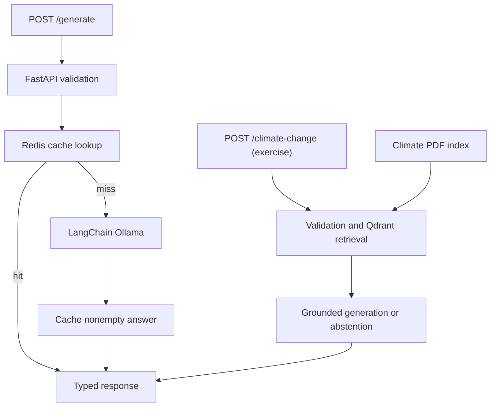

# Build LLM Inference APIs with FastAPI and Ollama

This lesson explores a local inference API that serves `qwen3.5:2b` through
Ollama, exposes typed endpoints with
FastAPI, and avoids repeated model calls with Redis caching.

Follow a request through the supplied application, inspect caching and tests,
then complete a guided retrieval augmented generation (RAG) exercise over a
climate change document. The `/generate` endpoint is ready to run;
`/climate-change` is the endpoint you add in the exercise.

## Learning Objectives

By the end of this repository, you should be able to:

- Build a FastAPI application that exposes local LLM inference backed by
  Ollama.
- Call Ollama asynchronously from an API layer through LangChain's Ollama
  integration.
- Implement Redis caching for repeated prompts and define graceful behavior
  when the cache is unavailable.
- Write unit tests that mock external model, cache, and retrieval dependencies.
- Extend an inference service with a small RAG workflow over a local document.

## Learning Path



| File / Folder | Description |
|---|---|
| [**01 - FastAPI and Ollama**](01-fastapi-and-ollama.md) | Typed API contracts and asynchronous local inference. |
| [**02 - Redis Cache**](02-redis-cache.md) | Cache identity and failure boundaries. |
| [**03 - Testing Boundaries**](03-testing-boundaries.md) | Isolated tests for external dependencies. |
| [**04 - RAG Extension**](04-rag-extension.md) | Metadata-preserving retrieval and grounded generation. |
| [**RAG Extension Starter Notebook**](rag-extension-starter.ipynb) | Build and inspect retrieval, then reuse it in the API. |

Read the first three lessons alongside the supplied code and tests. Then use
lesson 04 and the starter notebook for the RAG exercise. The separate reference
solution is available for comparison after your attempt.

### Additional Folders and Files

| File / Folder | Description |
|---|---|
| [**docs**](docs/) | Local climate report used as the retrieval source. |
| [**llm_app**](llm_app/) | Supplied inference application, tests, and RAG helpers to complete. |
| [**solution**](solution/README.md) | Separate reference implementation. Inspect after your attempt. |
| [**.env.example**](.env.example) | Local service settings. |
| [**docker-compose.yaml**](docker-compose.yaml) | Redis service for local development. |
| [**pyproject.toml**](pyproject.toml) | Project configuration and dependencies. |
| [**uv.lock**](uv.lock) | Dependency lock file. |

## Prerequisites

- **Docker Desktop**: required to run the local Redis cache container used by
  the API. Follow the [installation instructions](https://docs.docker.com/get-docker/)
  if you do not have it yet. Make sure it is **installed and running** before
  lesson 02.
- **Ollama**: required to run the local generation and embedding models.
  Install and start [Ollama](https://ollama.com/download), using the desktop
  app or `ollama serve` in a separate terminal. Then pull both local models:

  ```bash
  ollama pull qwen3.5:2b
  ollama pull mxbai-embed-large
  ```

  You can verify the generation model before starting the API:

  ```bash
  ollama run qwen3.5:2b "Explain why API input validation matters in one sentence."
  ```

> [!NOTE]
> **Windows Users:** The commands in this repository use bash syntax. Use
> **Git Bash** (installed with [Git for Windows](https://git-scm.com/downloads/win))
> instead of PowerShell to run them.

## Setup

Use [uv](https://docs.astral.sh/uv/getting-started/installation/) 0.13.5 or newer
and Python 3.13.17 or a newer 3.13 patch release, as defined in
[`.python-version`](.python-version).

> [!NOTE]
> Throughout these steps, text in angle brackets like `<repo-name>` is a
  **placeholder**. Replace it, including the `< >` brackets, with your own
  value. For example, `cd <repo-name>` becomes `cd mle-llms-webservice`.

### 1. Create the Repository from the Template

Click **Use this template** on GitHub.

When creating the repository:

- Set yourself as the **Owner**
- Choose a repository name
- Disable **Include all branches**
- Click **Create repository**

> [!IMPORTANT]
> If you are working in pairs or groups, only **one person** should complete
> this step.

---

### 2. Add Collaborators (Pairs/Groups Only)

If working with teammates:

1. Open the repository on GitHub
2. Go to **Settings → Collaborators**
3. Add your teammates as collaborators
4. Share the repository link with your team

Teammates should accept the invitation before continuing.

---

### 3. Clone the Repository

Copy the SSH URL from the **Code** button on GitHub, then run:

```bash
git clone <copied-ssh-url>
```

The copied SSH URL will look like `git@github.com:<your-username>/<repo-name>.git`.

---

### 4. Move into the Project Folder and Install Dependencies

This installs all dependencies and creates a virtual environment in `.venv/`.

```bash
cd <repo-name>
uv sync
```

Ollama and Docker are only needed for the live examples (see
[Prerequisites](#prerequisites)). The unit tests need neither service.

---

### 5. Set Up Environment Variables

Copy the local service settings:

```bash
cp .env.example .env
```

Keep the defaults for your first run. The models run locally through Ollama,
so no paid API key is required.

> [!CAUTION]
> Never commit `.env` to version control. It is git-ignored because environment
> files often hold secrets. Only `.env.example`, with placeholder or default
> values, belongs in the repository.

---

### 6. Open the Repository in VS Code

> [!NOTE]
> Make sure you open VS Code from the project root so it automatically detects
> the environment created by `uv sync`.

Launch VS Code in the project root folder:

```bash
code .
```

Then open a notebook and select the Python environment created by `uv sync` as
the kernel. Run all commands in the lessons from the repository root.

## API Usage Notes

- The RAG extension uses Qdrant local storage, so no Qdrant server or container
  is needed.
- The service disables Qwen's thinking mode so the small output-token budget is
  used for the final answer. Empty model responses return `502` and are not
  cached.
- Prompts are limited to 8,000 characters and RAG questions to 2,000. These are
  request-size limits, not tokenizer or context-window limits.
- Redis reads and writes each have a one-second deadline. `OLLAMA_TIMEOUT` in
  `.env` bounds generation, including streamed output, in seconds. The service
  returns `504` when that limit is reached and `502` for other Ollama failures.
- The example has no authentication or per-user quota. Keep it local unless you
  add access controls.
- Do not commit `.env`, local Qdrant data, Redis data, notebook outputs, or
  cache folders.

## References & Further Reading

- Ollama: [Docs](https://docs.ollama.com/) / [Model Library](https://ollama.com/library)
- Redis: [Docs](https://redis.io/) / [Asyncio Examples](https://redis.readthedocs.io/en/stable/examples/asyncio_examples.html)
- FastAPI: [Async Functions](https://fastapi.tiangolo.com/async/) / [Testing](https://fastapi.tiangolo.com/tutorial/testing/)
- LangChain: [Ollama Integration](https://docs.langchain.com/oss/python/integrations/llms/ollama) / [Qdrant Integration](https://docs.langchain.com/oss/python/integrations/vectorstores/qdrant)
