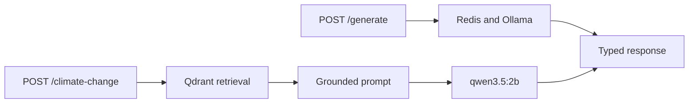

# Reference Solution

This folder contains a complete implementation of the local LLM web service.
It keeps HTTP routing, direct inference, caching, and retrieval in separate
modules so each external boundary can be replaced in tests.

Use it as an optional worked example after the lesson's RAG exercise.
The reference adds index-lifecycle and failure-handling checks beyond the starter.

## Read The Solution In This Order

1. [models.py](llm_app/models.py) defines both API contracts.
2. [inference.py](llm_app/inference.py) implements asynchronous Ollama calls and
   resilient exact-match caching.
3. [rag.py](llm_app/rag.py) loads the PDF, preserves page metadata, builds the
   Qdrant retriever, and constructs a grounded prompt.
4. [fastapi_llms.py](llm_app/fastapi_llms.py) exposes the two workflows as
   typed endpoints.
5. [tests/](tests/) checks route delegation and RAG behavior without live
   external services.



## Run The Reference Application

Prepare the shared environment and local services from the repository root as
described in the main README. Stop the starter API before running this
alternative on the same port:

```bash
uv run uvicorn solution.llm_app.fastapi_llms:app --reload
```

The first `/climate-change` request builds the reference Qdrant collection if it
does not exist. This requires Ollama and the `mxbai-embed-large` model. Generated
vector data remains under `solution/qdrant_climate_db/` and is ignored by Git.

The [solution notebook](rag_extension_solution.ipynb) uses a separate index in
`solution/notebook_climate_db/`. Run it from the repository root or `solution/`;
stable chunk IDs make reruns idempotent for the supplied unchanged PDF. Rebuild
the generated collection when changing the PDF, chunking, or embedding model.

The API records an index fingerprint and returns `409` if the PDF, chunk settings,
or embedding model name changes, or if an older index has no fingerprint.
Stop the API, move `solution/qdrant_climate_db/` aside, then restart and send a
request to rebuild. This also avoids retaining chunks from a shortened document.
The check runs when the index is opened, not on every request; restart after
changing inputs. Replacing model weights under the same name still requires a
manual rebuild.

Qdrant runs in-process: no server or additional container is needed. Only one
process can open each local directory; close the notebook client before reopening
its index in another kernel. The API shares one client
across requests and closes it on shutdown.

### Check Retrieval Calibration

With Ollama and `mxbai-embed-large` available, run from the repository root:

```bash
uv run python -m solution.check_retrieval
```

This checks six labeled questions from [retrieval_cases.json](retrieval_cases.json)
against a temporary index, without generation or changing the API index. It checks
abstention and whether at least one expected PDF page is retrieved. These are
sanity cases, not a held-out benchmark or proof of factual grounding; extend them
before tuning the threshold for another corpus.

## Run The Reference Tests

```bash
uv run pytest solution/tests
```

These tests use deterministic substitutes for inference and retrieval, so they
run without Ollama, Redis, or an existing Qdrant collection.

## Design Notes

- PDF pages are split as `Document` objects instead of one merged string, which
  preserves page metadata for source reporting.
- Qdrant initialization happens when the RAG endpoint is called, not when the
  FastAPI module is imported. The API and tests therefore start without loading
  a PDF or contacting Ollama.
- PDF parsing and initial indexing run outside the API event loop. RAG setup,
  retrieval, and generation share the configured deadline. A timed-out indexing
  thread may finish its current operation in the background; embedding calls also
  have a network timeout. Run one local API worker for this exercise.
- Redis failures degrade to uncached generation. Ollama failures return `502`
  because no valid generation result exists; timeouts return `504`.
- The retriever applies `MIN_RELEVANCE` to raw cosine similarities (initially
  0.60). When no chunk clears it, the service abstains before calling the model.
  The starter value still needs calibration against labeled supported and
  unsupported questions before production use.
- RAG answers have a 256-token generation limit as well as the request deadline.
  `OLLAMA_TIMEOUT` and `CACHE_TTL` must be positive; `MIN_RELEVANCE` must be in
  [0, 1].
- Retrieved text is treated as untrusted evidence, and citations to pages that
  were not retrieved, or factual responses without page citations, cause the
  reference service to abstain. Citation membership does not prove that each
  claim is supported: inspect the cited passages too. `sources` lists retrieved
  pages for a cited answer and is empty when the service abstains.
